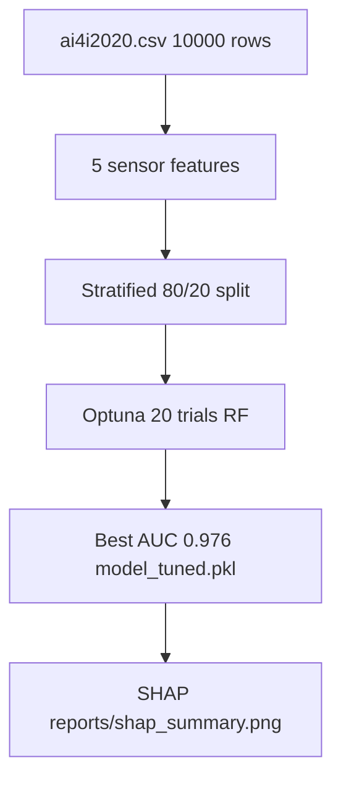

# AI4I 2020 Predictive Maintenance — Full ML Pipeline

## Why These Choices
- Random Forest ensemble: handles imbalanced failure class (~3.4%) without overfitting.
- Optuna tuning: best trial `n=122, d=12`, AUC 0.976.
- SHAP explainability: interpretable sensor-level failure drivers.

## Metrics (verified execution)
| Model | ROC-AUC |
|---|---|
| Baseline RF | 0.968 |
| Tuned RF | 0.976 |

- notebooks/01_eda.ipynb — EDA
- scripts/train_with_optuna.py — tuning
- src/model.pkl, model_tuned.pkl
- reports/shap_summary.png
