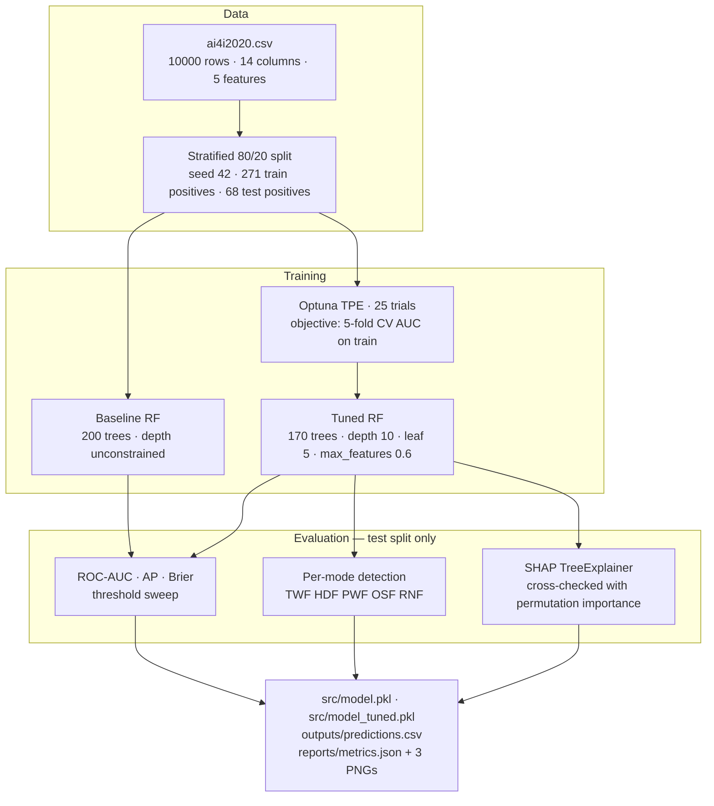
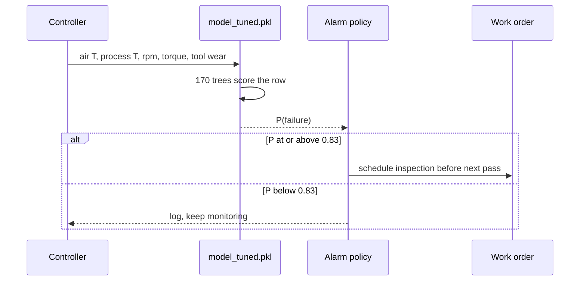
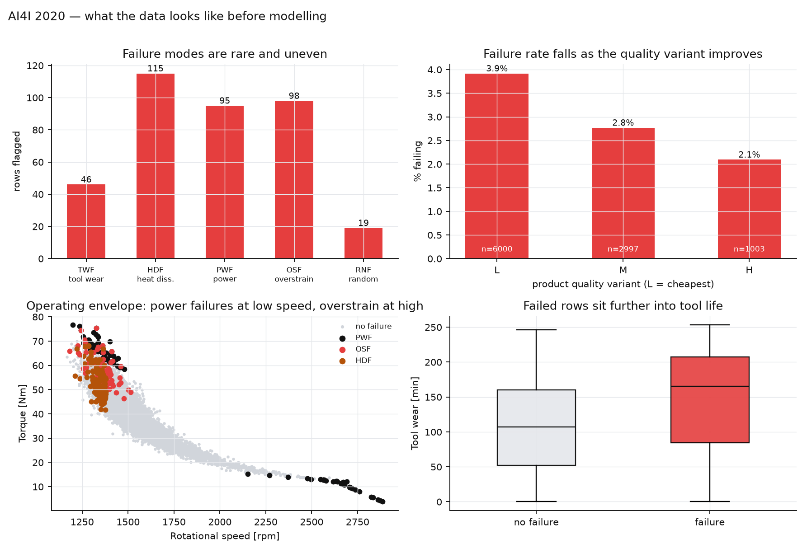
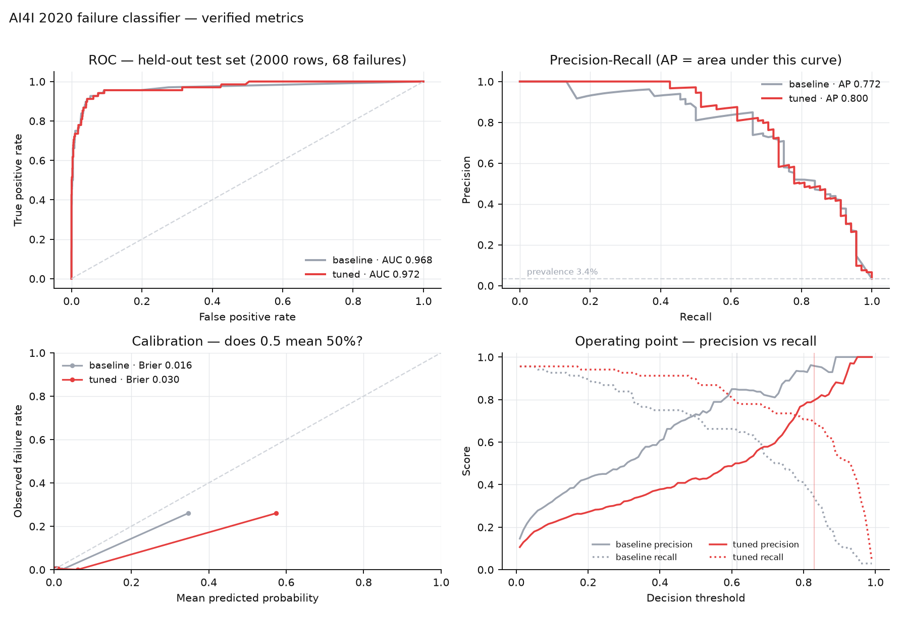
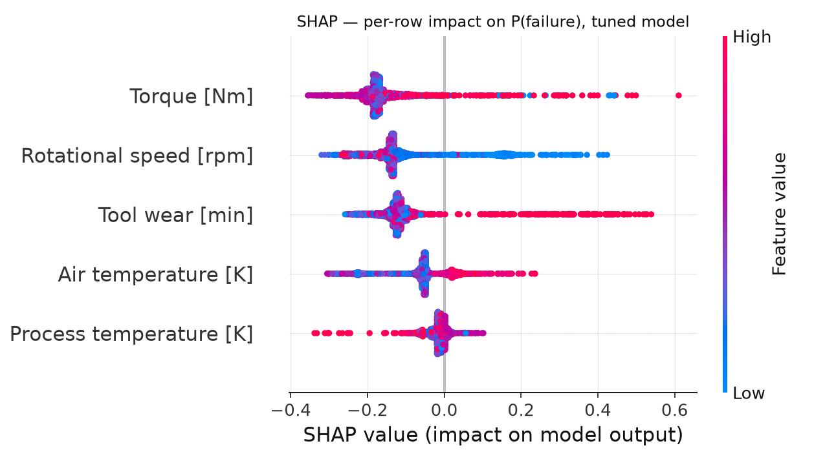

# AI4I 2020 — Predictive Maintenance with an Explainable Failure Classifier

A complete, reproducible pipeline that turns five raw sensor channels from a milling
process into a per-row probability of machine failure, then explains *why* each row
was scored the way it was.

The dataset is the AI4I 2020 synthetic milling table: 10,000 tool passes, each
described by air temperature, process temperature, rotational speed, torque and
tool wear, with a `Machine failure` flag and five one-hot columns naming the
failure mode. The target is rare (3.39%), the failure modes are physically
different from each other, and the interesting engineering question is not "can a
model rank these rows" — it is "which operating point would a plant actually run,
and can the model justify a single alarm".

Everything below was produced by running the code in this repository. Numbers come
from `reports/metrics.json`, which `scripts/evaluate.py` regenerates.

---

## Table of contents

- [What this is](#what-this-is)
- [Why the problem is harder than the AUC suggests](#why-the-problem-is-harder-than-the-auc-suggests)
- [Pipeline](#pipeline)
- [Inference flow](#inference-flow)
- [Data](#data)
- [Repository layout](#repository-layout)
- [Design decisions and why](#design-decisions-and-why)
- [Getting started](#getting-started)
- [Results](#results)
- [Per-failure-mode detection](#per-failure-mode-detection)
- [Explainability](#explainability)
- [What the model misses, and why](#what-the-model-misses-and-why)
- [Reproducing the reported numbers](#reproducing-the-reported-numbers)
- [Troubleshooting](#troubleshooting)
- [Where this would go next](#where-this-would-go-next)
- [Dataset and licence](#dataset-and-licence)

---

## What this is

| | |
|---|---|
| **Task** | Binary classification — will this tool pass fail? |
| **Input** | 5 continuous sensor channels per row |
| **Output** | `P(failure)` in [0, 1], a threshold, and per-feature SHAP attribution |
| **Primary metric** | ROC-AUC (threshold-free ranking) |
| **Secondary metrics** | Average precision, Brier score, precision/recall/F1 at a chosen threshold, per-mode detection rate |
| **Models** | Baseline random forest (fixed) and Optuna-tuned random forest (selected on 5-fold CV) |
| **Artifacts** | `src/model.pkl`, `src/model_tuned.pkl`, `outputs/predictions.csv`, `reports/` |

The deliverable is a working pipeline, not a write-up: two fitted models, a
scoring script that rebuilds every figure, and a test suite that fails loudly if
the saved pickles stop matching the training schema.

---

## Why the problem is harder than the AUC suggests

Four properties of this dataset shape every decision that follows.

**1. The positive class is 3.39% of the data.** Predicting "no failure" for every
row scores 96.6% accuracy. Accuracy, and any metric that is not rank-based, is
therefore close to worthless here. A model that never fires looks excellent on a
confusion matrix and useless on a shop floor.

**2. The five failure modes are not one phenomenon.** Tool wear failure (TWF, 46
rows), heat dissipation failure (HDF, 115), power failure (PWF, 95), overstrain
failure (OSF, 98) and random failure (RNF, 19) are driven by different physics:
HDF by the temperature differential at high torque, PWF by the torque–speed
combination exceeding the machine's power envelope, OSF by the same combination
exceeding the strain envelope, TWF by accumulated tool life. A model can be
"good" on the aggregate label while being blind to one mode entirely — which is
why per-mode detection is reported separately below.

**3. The label is mildly inconsistent.** `Machine failure` is meant to be the OR
of the five mode flags. It is not, for 27 of 10,000 rows: 9 rows are flagged as
failures with no mode attached, and 18 carry a mode flag but a zero overall flag.
That puts a floor under achievable accuracy on the aggregate target. Chasing the
third decimal of AUC past this point is fitting labelling noise.

**4. Two pairs of channels are near-duplicates.** Air and process temperature
correlate at 0.876; torque and rotational speed at −0.876 (the machine holds power
roughly constant, so more speed means less torque). Correlated inputs are not a
modelling problem for trees, but they do split attribution: SHAP and permutation
importance will disagree about which half of a correlated pair is "the" driver,
and the disagreement is a property of the data, not a bug.

---

## Pipeline



Two models are trained on purpose. The baseline is the honest "fixed settings a
reasonably careful engineer would pick without tuning" reference; the tuned model
earns its place only if it beats that reference on metrics that survive scrutiny.

---

## Inference flow

What happens to one row arriving from a controller:



The threshold is a policy parameter, not a property of the model. It belongs to
whoever pays for downtime versus inspections.

---

## Data

`data/ai4i2020.csv` — 10,000 rows, 14 columns, zero missing values.

| Column | Role | Notes |
|---|---|---|
| `UDI`, `Product ID` | dropped | identifiers, no signal, unique per row |
| `Type` | dropped (ablated) | product quality variant L/M/H — tested as a feature, see [design decisions](#design-decisions-and-why) |
| `Air temperature [K]` | feature | 295.3 – 304.5, mean 300.0 |
| `Process temperature [K]` | feature | 305.7 – 313.8, mean 310.0 |
| `Rotational speed [rpm]` | feature | 1168 – 2886, mean 1539 |
| `Torque [Nm]` | feature | 3.8 – 76.6, mean 40.0 |
| `Tool wear [min]` | feature | 0 – 253, mean 108 |
| `Machine failure` | **target** | 339 positives, 3.39% |
| `TWF`, `HDF`, `PWF`, `OSF`, `RNF` | dropped | failure-mode labels; including them is target leakage |

Distribution facts that matter:

| Quantity | Value |
|---|---|
| Failures | 339 / 10,000 (3.39%) |
| TWF · HDF · PWF · OSF · RNF | 46 · 115 · 95 · 98 · 19 |
| Rows with more than one mode | 24 |
| Rows with `Machine failure` = 1 but no mode set | 9 |
| Rows with a mode set but `Machine failure` = 0 | 18 |
| Quality variant L / M / H | 6000 / 2997 / 1003 |
| Failure rate by variant L / M / H | 3.9% / 2.8% / 2.1% |
| corr(torque, rpm) | −0.876 |
| corr(air temp, process temp) | 0.876 |



The bottom-left panel is the reason a tree model is a sensible default here:
power failures sit at low speed with high torque, overstrain failures at high
speed with low torque, and heat-dissipation failures in the high-torque band.
Those are axis-aligned and diagonal regions in a 2-D projection of a 5-D space —
exactly what recursive splits carve out cheaply and what a linear model would have
to be told about by hand (interaction terms, `torque × rpm`, thresholds).

---

## Repository layout

```
project/
├── data/
│   └── ai4i2020.csv           raw dataset, unchanged
├── notebooks/
│   └── 01_eda.ipynb           exploratory analysis; establishes every claim above
├── src/
│   ├── train_predict.py       baseline: fit, score, save model + predictions
│   ├── model.pkl              baseline estimator (joblib, 5.9 MB)
│   ├── model_tuned.pkl        CV-tuned estimator (joblib, 2.3 MB)
│   └── references/
│       └── dataset-notes.md   what the data supports, and what it does not
├── scripts/
│   ├── train_with_optuna.py   tuning study; selects on CV, never on test
│   └── evaluate.py            all metrics, all figures, metrics.json
├── reports/
│   ├── metrics.json           every number quoted in this README
│   ├── metrics_chart.png      ROC · PR · calibration · threshold sweep
│   ├── shap_summary.png       SHAP beeswarm for the tuned model
│   ├── eda_overview.png       modes, variants, operating envelope, tool wear
│   └── optuna_trials.csv      all 25 trials with parameters and CV scores
├── outputs/
│   └── predictions.csv        actual / predicted / prob_failure on the test split
├── tests/
│   └── test_smoke.py          6 tests: schema, probability range, ordering, leakage
├── requirements.txt
└── README.md
```

> [!NOTE]
> The `.pkl` files are gitignored on purpose: they are build artifacts, regenerated
> in about two minutes by the two training scripts. Clone, install, run — the
> model files are produced locally.

---

## Design decisions and why

Each choice below is stated with the alternative it replaced, because "we used a
random forest" is not a justification unless you say what it was chosen over.

### Random forest as the model family

*Chosen over:* logistic regression, gradient boosting, a neural network.

- **Non-linear, interacting regions.** PWF and OSF are threshold-shaped functions
  of torque *and* speed jointly; HDF depends on the temperature gap at high torque.
  A forest captures those splits without hand-built interaction terms. A logistic
  regression on the five raw channels would need `torque × rpm` and
  `process − air temperature` engineered first.
- **Sample size.** 8,000 training rows with 271 positives and 5 features is small
  tabular data, where ensembles of trees are still the strongest default and neural
  networks have nothing to learn that they cannot overfit.
- **Scale-free.** Splits are rank-based, so K versus rpm versus Nm versus minutes
  need no normalisation and no outlier clipping.
- **Correlated inputs are tolerated.** The torque/speed pair at r = −0.876 makes
  coefficient-based models unstable; bagged trees just split on whichever is
  locally cleaner.
- **Native probability output.** `predict_proba` gives a forest vote fraction that
  is monotone in the score and usable for thresholding, without an extra
  calibration layer for a first pass.

### `class_weight="balanced"`

*Chosen over:* plain fitting, SMOTE-style oversampling.

At 1:28 class imbalance, an unweighted tree's impurity criterion is dominated by
the majority class; errors on the 271 positives barely move the objective. Balanced
weights make a minority error cost roughly 28× a majority error, which shifts the
model toward recall. There is a real side effect, visible in
[results](#results): the balanced tuned model is *less* calibrated at probability
0.5 — its Brier score is worse (0.030 vs 0.016) even though its ranking is better.
That is expected and is the reason the threshold is chosen explicitly instead of
being left at the 0.5 default.

### Stratified 80/20 split, seed 42

The test split has 68 positives. An unstratified split of 339 positives can easily
land 60 or 76 of them in the test set, which moves test AUC by several points on
its own. Stratification pins the positive rate in both halves, and the fixed seed
makes every number in this README reproducible.

### Hyperparameters selected by 5-fold CV on the training split, not by test AUC

*Chosen over:* the common shortcut of scoring each trial on the test set and
keeping the best.

Selecting the maximum of 25 noisy test-set scores is selecting the maximum of 25
draws of noise: the winner's score is biased upward, and the reported AUC stops
being an estimate of how the model behaves on unseen data. It also silently
converts the test set into a validation set, leaving nothing honest to report.

Here the Optuna objective is the mean 5-fold stratified CV AUC computed **only on
the 8,000 training rows** (1,084 positive-fold instances instead of 68), and the
test split is scored once, after the final fit. The gap between the two is
informative: best CV AUC 0.9741 ± 0.0107, held-out test AUC 0.9719 — consistent,
with no sign of the inflation the shortcut produces.

### Optuna with TPE, 25 trials

*Chosen over:* grid search, random search, hand-tuning.

The search space is four-dimensional (tree count, depth, leaf size, feature
fraction); a coarse 6-value grid over four dimensions is 1,296 fits for far less
coverage. TPE fits a surrogate to the trials already run and samples where
improvement is plausible, so 25 trials reach CV AUC 0.974 in about two minutes on
a laptop. The sampler is seeded and every trial is written to
`reports/optuna_trials.csv`, so the study is inspectable rather than a black box.

### AUC as the primary metric, average precision as the honest companion

AUC is threshold-free, so it compares models without committing to an operating
point — useful when the operating point is a business decision. But AUC is
optimistic under heavy imbalance: it counts ranking improvements among true
negatives, of which there are 1,932. Average precision only looks at the positive
end. The prevalence line is AP = 0.034, so AP 0.80 is roughly a 23× lift over
random; that number is quoted alongside every AUC for that reason.

### SHAP for attribution, with permutation importance as a cross-check

*Chosen over:* Gini/impurity feature importance, or a single global bar chart.

Impurity importance is computed on the training data, is biased toward
high-cardinality continuous features, and — decisively — has no sign and no
per-row value. It cannot answer the question a maintenance engineer actually asks:
"why did *this* pass trip the alarm?" TreeSHAP attributes the prediction of one
row to its five features, exactly and in milliseconds for a forest this size, so
the artifact supports a conversation about a specific timestamp rather than a
generic ranking.

Because torque and speed are 0.876 correlated, SHAP (which splits credit between
collinear features) and permutation importance (which measures the AUC drop when
one column is shuffled, letting the model lean on its correlate) rank torque and
tool wear differently. Both are reported; neither alone is the truth.

### `Type` excluded from the feature set

The quality variant is available at inference time and does correlate with failure
rate (3.9% for L, 2.1% for H). It was tested as a one-hot ablation with the tuned
hyperparameters: test AUC 0.9741 with `Type` versus 0.9719 without, a +0.002
difference that is well inside the ±0.011 CV standard deviation. It was dropped:
no measurable gain, one more field to encode and validate in production.

---

## Getting started

Python 3.13 is what the reported numbers were produced with. Any 3.10+ should
work; exact package versions are pinned in `requirements.txt`.

```bash
# from the repository root
python -m venv .venv
source .venv/Scripts/activate      # Windows (git-bash); .venv/bin/activate on Linux/macOS
pip install -r requirements.txt
```

Then, in order:

```bash
python src/train_predict.py                    # baseline  -> src/model.pkl, outputs/predictions.csv
python scripts/train_with_optuna.py            # tuned     -> src/model_tuned.pkl, reports/optuna_trials.csv
python scripts/evaluate.py                     # scoring   -> reports/metrics.json + 3 PNGs
python -m pytest -q                            # 6 tests, ~1 s
```

`uv` works the same way and is faster:

```bash
uv venv .venv --python 3.13
uv pip install --python .venv/Scripts/python.exe -r requirements.txt
```

Every script takes `--data` if the CSV lives elsewhere, and `--trials` / `--folds`
for the study:

```bash
python scripts/train_with_optuna.py --data /path/to/ai4i2020.csv --trials 50 --folds 5
```

Runtime on a 4-core laptop: baseline about 5 s, 25-trial study about 2.5 min,
evaluation (SHAP plus 10-repeat permutation importance) about 30 s.

> [!NOTE]
> The CSV ships with a UTF-8 BOM. `pandas.read_csv` without
> `encoding="utf-8-sig"` names the first column with a BOM prefix and every
> downstream column lookup fails confusingly. All loaders here go through one
> helper that sets it.

---

## Results

Held-out test set: 2,000 rows, 68 failures. Threshold 0.5 unless stated.

| Model | ROC-AUC | Avg precision | Brier | Precision | Recall | F1 | TP / FP / FN |
|---|---|---|---|---|---|---|---|
| Baseline RF (200 trees, no depth cap) | 0.9678 | 0.772 | 0.0156 | 0.731 | 0.721 | 0.726 | 49 / 18 / 19 |
| Tuned RF (170 trees, depth 10, leaf 5, 0.6 features) | **0.9719** | **0.800** | 0.0297 | 0.430 | **0.897** | 0.581 | 61 / 81 / 7 |
| Baseline at its best-F1 threshold (0.615) | 0.9678 | 0.772 | 0.0156 | 0.849 | 0.662 | 0.744 | 45 / 8 / 23 |
| Tuned at its best-F1 threshold (0.830) | **0.9719** | **0.800** | 0.0297 | 0.800 | 0.706 | **0.750** | 48 / 12 / 20 |

Cross-validation on the training split (5-fold, same parameters as the tuned
model): folds 0.9888 · 0.9742 · 0.9603 · 0.9825 · 0.9645, **mean 0.9741 ± 0.0107**.



Reading this honestly:

- The tuned model ranks better — AUC +0.004, and average precision +0.028, which
  is the more meaningful gain at 3.4% prevalence.
- At the default 0.5 threshold it looks *worse* on F1 (0.581 vs 0.726) because
  balanced class weights and `min_samples_leaf=5` push probabilities upward: it
  fires on 81 false positives to catch 61 of 68 failures. The bottom-left
  calibration panel shows the same thing — the tuned curve sits above the diagonal.
- The 0.5 threshold is simply the wrong place to read a balanced model. At its
  own best-F1 threshold (0.83) it delivers F1 0.750 with 12 false positives, and
  it dominates the baseline: same precision band, more failures caught.
- The difference between the two models is smaller than the CV spread (±0.011).
  Claiming "tuning improved the model" beyond that would be over-reading a 68-
  positive test set. What tuning genuinely bought is a lower-variance forest
  (shallower trees, leaf size 5) that is 2.6× smaller on disk and cheaper to score.

**Operating point, not just a score.** The asymmetry is the whole point: a missed
failure is unplanned downtime, a false alarm is a scheduled inspection. At
threshold 0.5 the tuned model catches 61 of 68 failures (89.7% recall) for 81
inspections of healthy machines out of 1,932 — 4.2% of the passing fleet. If
inspections are cheap relative to downtime, that is the operating point to run;
if they are expensive, move the threshold to 0.83 and accept 20 missed failures
for 12 false alarms.

> [!WARNING]
> The best-F1 thresholds above were computed on the test set for illustration.
> In production the threshold must be chosen on a validation split the model has
> never seen (or, better, on a cost curve from the plant), otherwise the reported
> operating-point metrics are optimistic.

---

## Per-failure-mode detection

Overall recall hides the interesting structure. Share of rows of each mode that
exceeded the 0.5 threshold in the tuned model (test split):

| Mode | Rows in test | Flagged by tuned @0.5 | Flagged by baseline @0.5 | Mean P(failure), tuned |
|---|---|---|---|---|
| TWF — tool wear failure | 10 | 0.60 | 0.10 | 0.454 |
| HDF — heat dissipation | 29 | 0.97 | 0.90 | 0.896 |
| PWF — power failure | 13 | 0.92 | 0.92 | 0.910 |
| OSF — overstrain failure | 16 | 1.00 | 0.75 | 0.856 |
| RNF — random failure | 4 | 0.50 | 0.00 | 0.369 |

Two findings worth more than the aggregate AUC:

- **RNF is not learnable from these inputs.** It is a random failure by
  construction; a mean probability of 0.37 is the model noticing that those rows
  happen to look somewhat worn. Any claim of high recall on RNF would be luck.
- **TWF improves most from tuning (0.10 → 0.60) but remains the weakest real
  mode.** With only 10 TWF rows in the test split, that number is worth ±20
  points. The honest reading is "some signal, no confidence".

---

## Explainability



Mean absolute SHAP value on the test split, with the sign correlation between
feature value and contribution (positive = larger value pushes the row toward
failure):

| Feature | Mean absolute SHAP | Direction corr. | Permutation importance (AUC drop) |
|---|---|---|---|
| Torque [Nm] | 0.173 | +0.35 | 0.068 |
| Rotational speed [rpm] | 0.151 | −0.39 | 0.092 |
| Tool wear [min] | 0.138 | +0.51 | **0.118** |
| Air temperature [K] | 0.066 | +0.51 | 0.066 |
| Process temperature [K] | 0.020 | −0.22 | 0.009 |

What this says in engineering terms:

- **Torque is the highest-leverage single reading, and more torque is worse.**
  The beeswarm is asymmetric: high-torque rows spread far to the right, low-torque
  rows sit near zero. It is a risk *band*, not a threshold.
- **Speed acts as the mirror image** (negative correlation): high rpm at the same
  power envelope is protective against power failure, which is consistent with the
  torque–speed trade-off in the envelope plot.
- **Tool wear is the most monotone driver** (+0.51) and wins the permutation
  ranking outright. Worn tools raise risk gradually across the whole range; there
  is no single "change the tool at 200 min" cliff in these five channels.
- **Process temperature contributes almost nothing on its own** (0.020, and
  permutation 0.009) — because it is 0.876 correlated with air temperature and
  adds little beyond it. The pair matters; either member alone carries the signal.
- **SHAP and permutation disagree on torque vs tool wear** (0.173 vs 0.138 by
  SHAP, 0.068 vs 0.118 by permutation). This is the correlation effect, not an
  inconsistency: permutation removes the column and the forest substitutes its
  correlate, understating torque's role; SHAP splits credit across collinear
  features, understating each individually. Reporting both is the honest option.

A single row's explanation is the artifact that makes this actionable:

```python
import joblib, shap, pandas as pd

clf = joblib.load("src/model_tuned.pkl")
row = pd.read_csv("data/ai4i2020.csv", encoding="utf-8-sig").loc[[17],
      ["Air temperature [K]", "Process temperature [K]",
       "Rotational speed [rpm]", "Torque [Nm]", "Tool wear [min]"]]

print(clf.predict_proba(row)[:, 1])                    # P(failure)

sv = shap.TreeExplainer(clf).shap_values(row)
sv = sv[..., 1] if getattr(sv, "ndim", 2) == 3 else sv[0]
for feat, value in sorted(zip(row.columns, list(sv[0])), key=lambda t: -t[1]):
    print(f"{feat:26s} {row.iloc[0][feat]:8.1f}  {value:+.4f}")
```

> [!NOTE]
> SHAP's return shape depends on the estimator and version: scikit-learn forests
> in recent SHAP releases return `(rows, features, 2)` for binary targets, so the
> positive-class slice `[..., 1]` is required. Passing the 3-D array straight to
> `summary_plot` renders a nonsense "SHAP interaction value" chart instead of the
> beeswarm — a failure that looks like a plot style choice rather than an error.

---

## What the model misses, and why

Stated plainly, because a README that claims everything works does not survive
its first reader:

1. **27 rows carry contradictory labels.** Nine are failures with no mode flag,
   eighteen have a mode but no failure flag. No model can resolve this; it caps
   achievable accuracy on the aggregate target.
2. **No sequence structure is used.** The data is one row per pass with no
   timestamp and no machine identifier. Tool wear is a ramp, and a model that saw
   the last *k* passes of the same tool would detect the ramp rather than treat
   wear as a level. This file cannot express that, so the capability is not claimed.
3. **No machine identity means no grouped split.** Rows from the same machine
   cannot be kept in the same fold, so the CV estimate slightly overstates
   performance on a genuinely new machine.
4. **RNF is unlearnable** from five physical channels (19 rows, random by design).
5. **The 68-positive test set limits resolution.** A ±0.011 CV standard deviation
   on 1,084 fold-positives is the honest uncertainty band; differences smaller
   than that between two models are not real.
6. **Calibration is untuned.** Brier 0.030 with balanced weights means raw
   probabilities are over-confident. If a plant wanted to read probabilities
   directly ("this row is 30% likely to fail"), isotonic or Platt calibration on a
   validation split would be the next step, and it would change every
   threshold-based number in this README.

---

## Reproducing the reported numbers

```bash
git clone <this repository> && cd project
python -m venv .venv && source .venv/Scripts/activate
pip install -r requirements.txt

python src/train_predict.py           # expect: ROC-AUC 0.9678
python scripts/train_with_optuna.py   # expect: best CV AUC ~0.974, test AUC ~0.972
python scripts/evaluate.py            # rewrites reports/metrics.json
python -m pytest -q                   # expect: 6 passed
```

Exact reproducibility caveats:

- The split seed (42), forest seeds and Optuna sampler seed are fixed, so the
  baseline and the study are deterministic on the same library versions.
- `RandomForestClassifier(n_jobs=-1)` parallelises across threads with a fixed
  seed, but floating-point reduction order can vary by platform; AUC may differ in
  the third decimal across machines. The pinned versions in `requirements.txt`
  reproduce the table above on Python 3.13 / Windows.
- SHAP values are exact TreeSHAP, not sampled, so the attribution table is stable.

---

## Troubleshooting

| Symptom | Cause | Fix |
|---|---|---|
| `KeyError: 'Air temperature [K]'` | BOM in the CSV header, so the first column is not `UDI` | read with `encoding="utf-8-sig"` (all loaders here do) |
| `ModuleNotFoundError: optuna` / `shap` | installed into a different interpreter than the one running | `python -m pip install -r requirements.txt`, then run with the same `python` |
| Study is very slow on Windows | nested `n_jobs=-1` (CV outer, forest inner) oversubscribes cores | the study uses `n_jobs=1` on the CV loop and `-1` inside the forest for exactly this reason |
| `TypeError: Axes.boxplot() got an unexpected keyword argument 'labels'` | matplotlib 3.9+ renamed it | use `tick_labels=` (as in `scripts/evaluate.py`) |
| SHAP plot shows "SHAP interaction value" instead of a beeswarm | 3-D SHAP array passed through unsliced for a binary target | slice the positive class: `sv[..., 1]` |
| Tuned model's F1 at 0.5 is worse than baseline | balanced weights shift probabilities up; 0.5 is not its operating point | compare at each model's best-F1 threshold, or calibrate first |
| `joblib.load` warns about version mismatch | pickle built with a different scikit-learn | refit: `python src/train_predict.py && python scripts/train_with_optuna.py` |

---

## Where this would go next

Ordered by expected gain per unit of effort, not by novelty:

1. **Pick the threshold on cost, on a validation split.** False negative = unplanned
   downtime, false positive = one inspection. With real cost numbers this pipeline
   already answers the deployment question; nothing else needs to change.
2. **Calibrate.** Isotonic regression on a held-out slice makes `P(failure)`
   readable and stabilises every threshold-based metric.
3. **Per-mode heads.** Five one-vs-rest models (or one multi-label forest) would
   let the alarm say *which* mode is likely, which is what determines the
   maintenance action. HDF, PWF and OSF are already well separated; TWF is the one
   that needs different features.
4. **Sequence features.** If pass-level history and machine IDs became available,
   rolling wear deltas, time since tool change and per-machine baselines would
   attack TWF and RNF — the two modes this tabular setup cannot reach.
5. **Drift monitoring.** Watch the input distribution of torque and tool wear; the
   model is a snapshot of one synthetic operating regime.

---

## Dataset and licence

`data/ai4i2020.csv` is the AI4I 2020 Predictive Maintenance dataset, distributed
by the UCI Machine Learning Repository (CC BY 4.0). It is synthetic data generated
to mirror a real milling process; the failure modes are modelled, so absolute
precision and recall here are not transferable to a specific machine.

The domain framing — five physical channels, five physical failure modes, and
attribution as the artifact a maintenance engineer needs — follows the standard
predictive-maintenance literature on explainable models for tabular sensor data.
The implementation, hyperparameters, thresholds and every number in this README
were produced by this repository's code.
